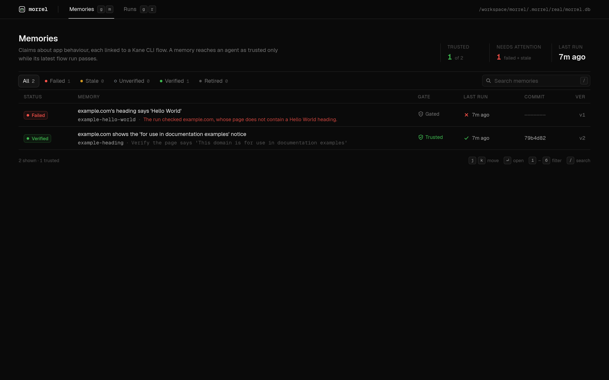
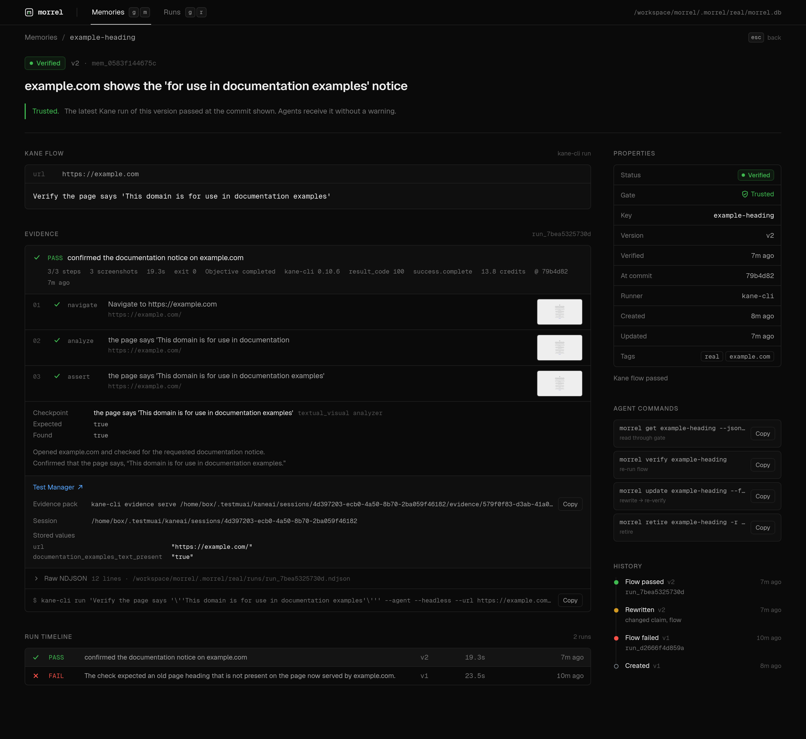
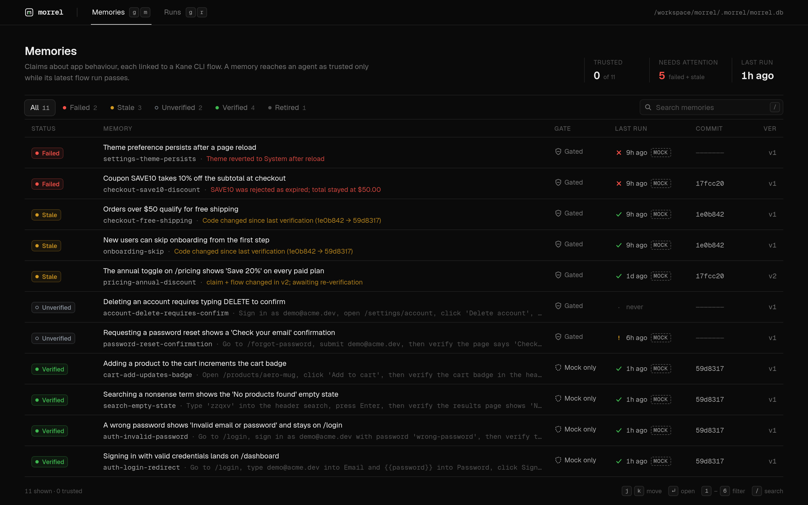
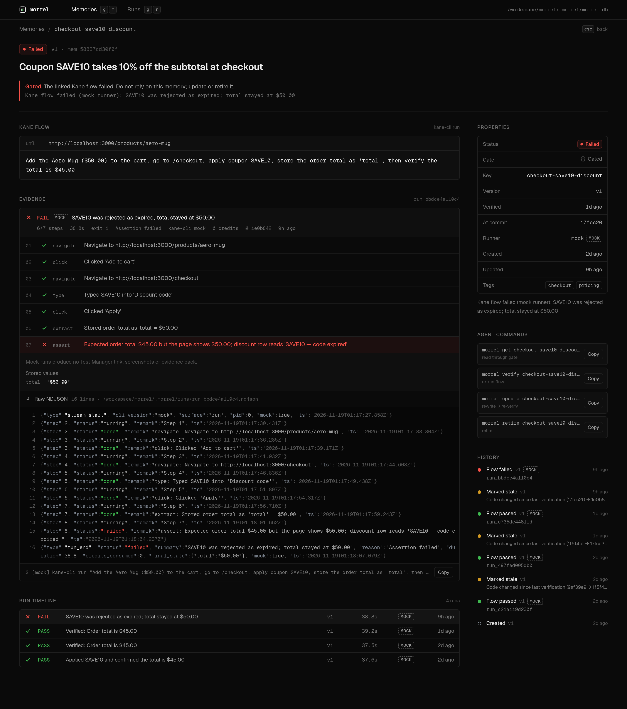
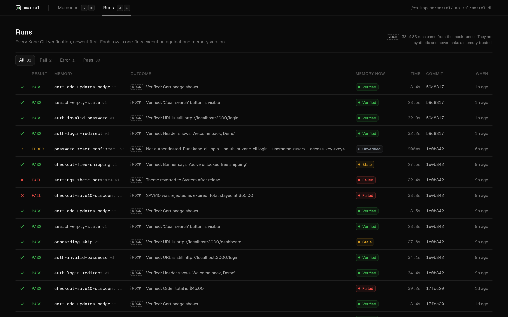

# Morrel

**A memory store for coding agents where a memory is trusted only while its Kane CLI flow passes.**

Agents accumulate beliefs about the app they work on — *"login redirects to /dashboard"*, *"SAVE10 takes 10% off"*.
Those beliefs rot silently as code changes. In Morrel, every memory is a **claim** linked to a
**[Kane CLI](https://www.testmuai.com/support/docs/kane-cli-introduction/) flow** that proves it in a real browser.

- A Kane run passes → the memory is **verified** and reaches agents as trusted.
- The flow fails → **failed**. A new commit, or a rewritten claim/flow → **stale**. Never run → **unverified**.
- Agents read through a **gate**: `morrel get <key> --json --strict` returns `trusted: false` + a warning (and exits 3) for anything not verified.
- On failure the agent **updates** (new version → stale → re-run) or **retires** the memory. That closes the loop.

Non-goals: cryptographic proofs, general-purpose memory, multi-user/auth/billing. "Verified" means one thing: the latest Kane run of the current version passed.

### Real Kane CLI runs (kane-cli 0.10.6, 19 Nov 2026)

| Board | Trusted memory: real pass, step screenshots, Test Manager link |
| --- | --- |
|  |  |

What happened, start to finish:
1. We recorded the claim from the Kane docs' own example: *"example.com's main heading says 'Example Domain'"*. A real Kane run **failed** (`result_code 710`). example.com no longer renders that heading: "Example Domain" only survives in `<title>`. Kane's triage labelled it `automation_bug / config_issue · 97%`, an outdated expectation. ([screenshot](docs/screenshots/real-detail-stale-heading-run.png))
2. We rewrote the memory with `morrel update`. That bumped it to v2 and marked it stale, then the real re-run **passed**. The gate now returns `trusted: true`.
3. A false claim (*"heading says 'Hello World'"*) **failed** (`result_code 750`) and stays gated. ([screenshot](docs/screenshots/real-detail-failed.png))

### Demo data (mock runner)



| Memory detail (failed, with step evidence + raw NDJSON) | Runs log |
| --- | --- |
|  |  |

> These screenshots use `pnpm seed` demo data. **Every run in them comes from the mock runner** (labelled `MOCK`), so no memory shows as *Trusted*: the gate never trusts mock passes.

## Architecture

```
packages/
  core/   @morrel/core — SQLite schema + migrations (node:sqlite), typed repository, read gate,
          Kane CLI wrapper (spawn + NDJSON parser), mock runner, verify orchestration. Vitest tests.
  cli/    @morrel/cli  — `morrel` binary (commander). init/add/list/get/verify/update/retire/runs/install-hook.
  web/    @morrel/web  — Next.js 16 App Router status board (server components read the same DB).
  mcp/    @morrel/mcp  — stdio MCP server (memory_create/get/list/verify/update/retire) over the same core API.
scripts/  seed.mjs (demo data, mock runs) · screenshots.mjs (headless Chrome)
```

```
 agent ──morrel add/update──▶ ┌────────────┐ ──verify──▶ kane-cli run "<objective>" --agent --headless
                              │  SQLite    │ ◀─NDJSON──  (stream_start · step lines · run_end)
 agent ◀──morrel get (gate)── │ .morrel/   │
 git commit ──hook──▶ mark-stale + verify --all          board (Next.js) reads the same file
```

**Data model** (`packages/core/src/schema.ts`)

- `memories` — `id, key, claim, flow_objective, flow_url, flow_file, status (verified|failed|stale|unverified|retired), status_reason, tags, version, created_at, updated_at, last_verified_at, git_sha, last_run_id, last_runner (kane|mock), retired_at`
- `runs` — `id, memory_id, memory_version, runner, started_at, finished_at, result (pass|fail|error), exit_code, duration_ms, summary, reason, git_sha, command, evidence (JSON: steps, links, final_state, warnings…), raw_ndjson_path`
- `memory_events` — append-only history: `created, updated, retired, run_passed, run_failed, run_error, marked_stale` with from/to status and a JSON snapshot.
- Migrations are ordered SQL strings tracked by `PRAGMA user_version`.

**Status rules**

| Event | New status |
| --- | --- |
| create | `unverified` |
| run → `pass` (current version) | `verified` (records `git_sha`, `last_verified_at`) |
| run → `fail` | `failed` |
| run → `error` (Kane didn't start / timed out / no `run_end`) | unchanged proof → `stale` if it was verified, else stays `unverified`/`failed` |
| `update` changes claim or flow | `version+1`, `stale` |
| new commit (`verify --all`, hook, `mark-stale`) | verified memories with an older `git_sha` → `stale` |
| run of an older version finishes after an update | kept in history, status untouched |
| `retire` | `retired` (never trusted) |

`trusted = status == verified && last_runner == kane` (mock passes are only trusted with `MORREL_TRUST_MOCK=1`).

## Kane CLI integration

Researched against `@testmuai/kane-cli@0.10.6` (installed on this box) and the official docs (Agent Mode, CLI reference, Authentication, the skill's `parsing.md`).

- Command: `kane-cli run "<objective>" --agent --headless [--url <url>] [--max-steps n] [--timeout s]`; test files: `kane-cli testmd run <file>_test.md --agent`.
- `--agent` → stdout is NDJSON (stream contract `v: 1`), progress UI on stderr. stdin is not a TTY, so `ask_user` is off.
- Stream: `stream_start` first; **untyped** step lines `{step, status: running|done|failed, remark}`; typed `warning`, `error`, `bifurcation`, …; final `run_end {status: passed|failed, summary, one_liner, reason, duration, credits_consumed, final_state, test_url, session_dir, result_code}`. `testmd` ends with `test_md_done {overall_status, duration_s, share_url}`.
- Exit codes (docs): 0 pass · 1 did not pass / upload failed · 2 did not start · 3 cancelled/timeout.
- The evidence pack path is only on **stderr**: ``evidence: view locally with `kane-cli evidence serve <path>` `` — Morrel scrapes it.
- Auth: `kane-cli login --oauth` once, or basic auth. Morrel forwards `LT_USERNAME` / `LT_ACCESS_KEY` as `--username/--access-key` when set.

Morrel's parser (`packages/core/src/kane/parser.ts`) decides from the completion event, not the exit code: **no `run_end` means `error`**, because the run proves nothing either way.

**Real runs differ from the docs here** (all captured as fixtures in `packages/core/test/fixtures/real-*`):
- Unauthenticated: exit **1** (docs say 2), with only `stream_start` and `recording_state`, no `run_end`.
- The evidence pack path **is on stdout**: in a `coverage` event (`pack`) and in `run_end.coverage`, as well as the stderr hint.
- `run_end.result_code` is a **number** (`100` pass, `710` final-verification assertion, `750` step not achievable). `per_flow_metadata[].result_code` is a string.
- `run_end.verdict` (Kane's own triage: status, family, category, severity, confidence, suggestion) appears on failures **without** `--bug-detection`. `reason_code` is present too (`success.complete`, `assertion_error.final_verification`, `assertion_error.step_not_achievable`).
- `run_end.context.memory` holds each checkpoint's **expected vs extracted** value, which Morrel shows as "Expected / Found".
- Extra typed events: `recording_state`, `skill_update_available`. Extra `run_end` fields: `bifurcated`, `total_runs`, `run_id`, `run_dir`.
- Step remarks use verbs `navigate`, `analyze`, `assert`, `wait`. `analyze` remarks look like `ANALYZE(textual_visual, "…` and are cut off by Kane. A failed run can end on a `wait` step, so the useful text is in `one_liner`/`reason`.
- The sealed `.evidence` zip contains `tests/<slug>/steps/<n>-0-<n>/{step.json,screenshot.jpg}`. Morrel extracts the screenshots into `.morrel/runs/<run_id>/` and the board shows them per step.
- Credits per run: 12.46, 12.58, 13.82 (a 3-step example.com check costs about 12–14 credits).

**Credentials.** `LT_USERNAME`/`LT_ACCESS_KEY` are passed to kane-cli as flags. They are scrubbed (`[REDACTED]`) from raw NDJSON, stderr, evidence and summaries before anything is written, and they never appear in the stored command. Committed fixtures also replace Test Manager ids and share tokens.

`morrel import-run <key> <file.ndjson> --exit <code> [--stderr file]` records a real run captured elsewhere, such as CI. It refuses mock streams.

**Mock runner**: `MORREL_KANE_MOCK=1` or `--mock` emits a synthetic stream in the documented shape and sends it through the same parser. Runs are stored with `runner = "mock"`, the CLI prints `MOCK`, the board shows a dashed `MOCK` tag, and the gate refuses to trust them. `MORREL_MOCK_FAIL="key1,check*"` forces failures for demos.

## Setup

Requires Node ≥ 22.13 (uses built-in `node:sqlite`; better-sqlite3's native build failed on this box's Node 24, so it was dropped) and pnpm.

```bash
pnpm install
pnpm build            # core → cli → web
pnpm test             # core unit tests (parser fixtures, store, verify orchestration)
pnpm seed             # optional demo data (mock runs) into ./.morrel/morrel.db
pnpm dev              # board on http://localhost:3100
```

For real verification: `npm i -g @testmuai/kane-cli && kane-cli login` (or export `LT_USERNAME` / `LT_ACCESS_KEY`).

## CLI

```bash
alias morrel="node $(pwd)/packages/cli/dist/index.js"   # or: pnpm --filter @morrel/cli link --global

morrel init
morrel add "Login redirects to /dashboard" \
  --flow "Log in as demo@acme.dev, then verify the URL is /dashboard" \
  --url http://localhost:3000 [--key auth-login] [--tag auth] [--verify]
morrel list [--status failed] [-q search] [--all]
morrel get auth-login [--json] [--strict]       # read gate; --strict exits 3 when untrusted
morrel verify auth-login | --all [--mock] [--timeout 300] [--headed]
morrel update auth-login --flow "…" [--claim "…"] [--no-verify]   # bumps version → stale → re-verifies
morrel retire auth-login -r "feature removed"
morrel runs [key]
morrel install-hook [--hook post-commit|pre-push]
morrel mark-stale
morrel import-run auth-login run.ndjson --exit 1 --stderr run.stderr.txt
```

Global: `--json`, `--db <path>` (or `MORREL_DB`). Exit codes: `0` ok · `1` a verification did not pass · `2` usage/invalid · `3` untrusted (`get --strict`) · `4` not found.

**Hooks.** `post-commit` marks verified memories stale for the new commit synchronously, then runs `morrel verify --all` in the background (log: `.morrel/hook.log`), never blocking the commit. `pre-push` runs `verify --all` and blocks the push if anything fails.

## Board

`packages/web` — server components open the same SQLite file (`MORREL_DB` or `<repo>/.morrel/morrel.db`) per request and auto-refresh every 5 s, so CLI and hook runs appear live.
Pages: **Memories** (status filters with counts, search, gate column, last run, commit, version), **Memory detail** (gate banner, flow, step-by-step evidence, artifact links, stored values, raw NDJSON + stderr, run timeline, history), **Runs**.
Keys: `/` search · `j`/`k` move · `↵` open · `1`–`6` filter · `g m` / `g r` navigate · `esc` back.

## MCP server

`packages/mcp` is a stdio MCP server built on `@modelcontextprotocol/sdk`. It exposes the same core API, so agents can use the gate natively:

| Tool | What it does |
| --- | --- |
| `memory_create` | claim + Kane `objective`/`url` (or `file`); optional `verify: true` |
| `memory_get` | read gate: `{ status, trusted, warning, lastRun: { steps, checks, testUrl } }` |
| `memory_list` | counts + every memory's gate verdict (filter by `status`, `search`) |
| `memory_verify` | `key` or `all: true` (marks stale for the current commit first) |
| `memory_update` | rewrite claim/flow, which bumps the version, marks it stale and re-verifies (`verify: false` to skip) |
| `memory_retire` | retire with a reason |

```bash
pnpm build
pnpm --filter @morrel/mcp test     # spawns the server and drives it with the official MCP client (mock runner)
```

**Claude Code**

```bash
claude mcp add morrel -e MORREL_DB=/abs/path/to/your-app/.morrel/morrel.db -- node /abs/path/to/morrel/packages/mcp/dist/index.js
```

**Cursor**: `.cursor/mcp.json` in your app repo (or `~/.cursor/mcp.json`):

```json
{
  "mcpServers": {
    "morrel": {
      "command": "node",
      "args": ["/abs/path/to/morrel/packages/mcp/dist/index.js"],
      "env": { "MORREL_DB": "/abs/path/to/your-app/.morrel/morrel.db" }
    }
  }
}
```

Kane auth is inherited from the environment: either a prior `kane-cli login`, or add `LT_USERNAME` / `LT_ACCESS_KEY` to `env`. Set `MORREL_KANE_MOCK=1` there for credit-free demos (those runs are never trusted).
